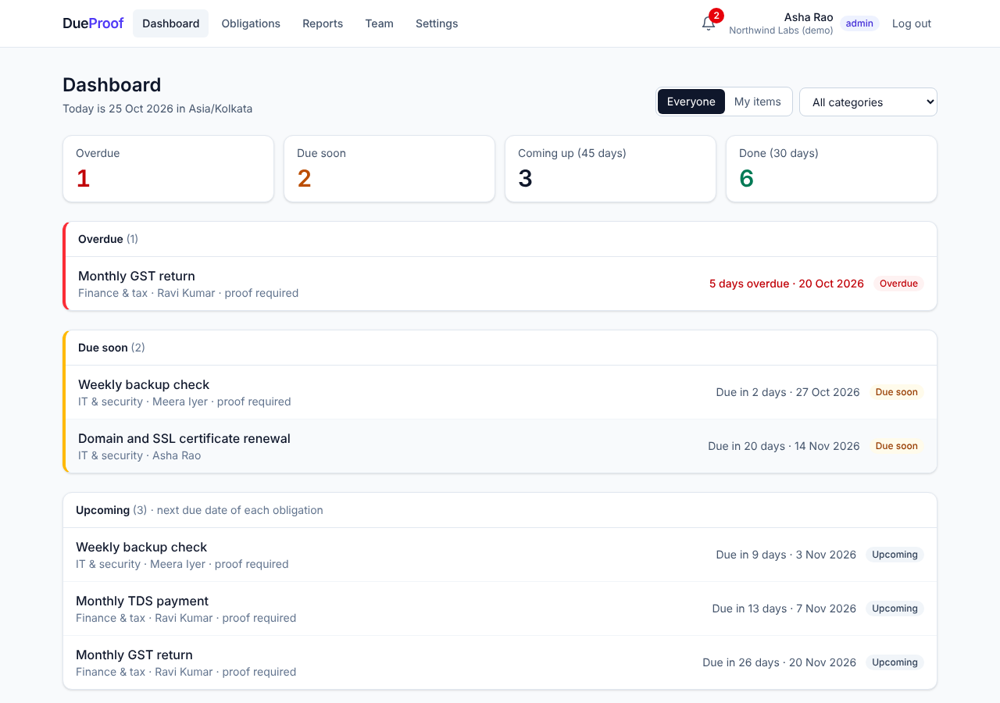
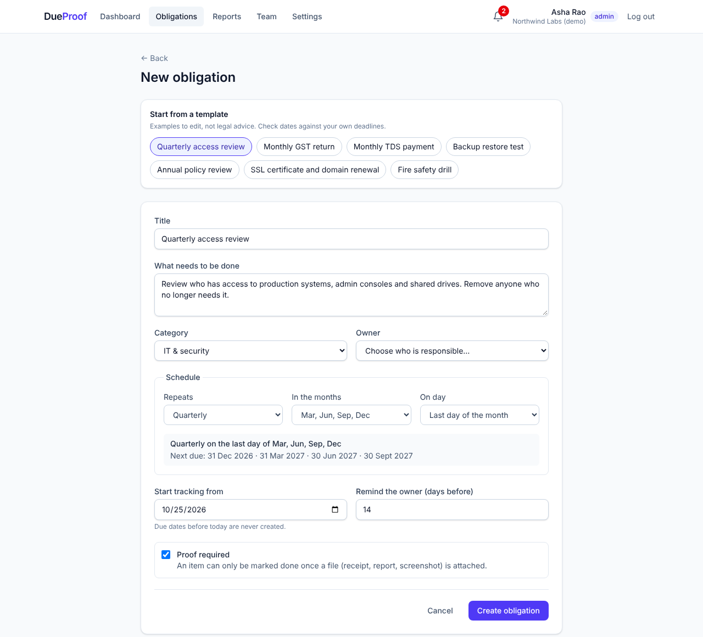
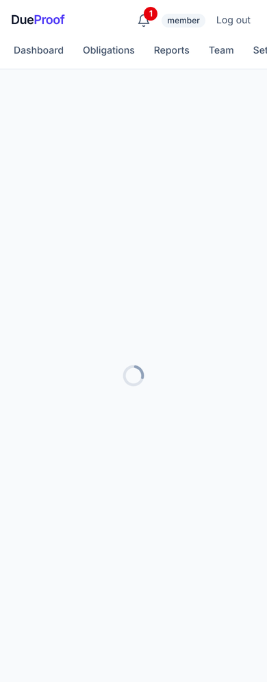
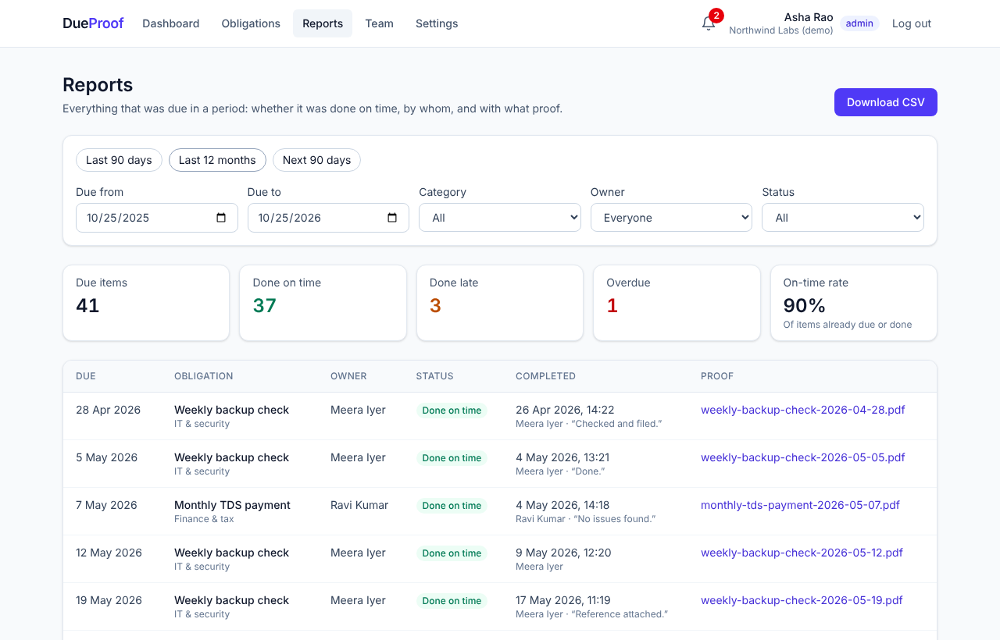
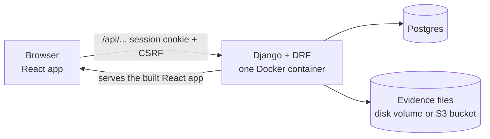

# DueProof

**Recurring compliance tasks, done on time, by the right person, with proof.**

DueProof is a small web app for teams that have to do the same compliance work again and again (tax filings, access reviews, backup tests, licence renewals) and later prove they did it. Each task recurs on a schedule, has one owner, can't be marked done without proof, and ends up in an audit-ready report.

- **Live app:** `<add your Railway URL>`: the home page explains the product; **Explore the demo** logs you straight into a sample company
- **Demo video (2–3 min):** `<add link>`
- **Demo logins** (password for all three: `DueProof-Demo-2026`):

  | Email | Role | Sees |
  |---|---|---|
  | `admin@dueproof.demo` | Admin | Everything; can create obligations, invite people, reopen items |
  | `ravi@dueproof.demo` | Member | Owns the tax filings (one is overdue) |
  | `meera@dueproof.demo` | Member | Owns the security checks (one is due in 2 days) |



---

## The problem

Every organization has recurring obligations it must meet on schedule and may have to prove later: a monthly GST return, a quarterly access review, a backup restore test, an annual policy review, a certificate renewal.

In small teams (10–100 people) these live in a spreadsheet, a few calendar reminders, or one person's head. That fails in three predictable ways:

1. **No single owner.** Reminders go to a shared inbox or one person. When they're on leave or leave the company, the task is quietly missed.
2. **No proof.** The work gets done, but the receipt, signed review or test result is scattered across email and drives. When an auditor, client or investor asks, someone spends days reconstructing it.
3. **No early warning.** Nobody sees an item is late until there's a penalty, a failed audit or an outage.

**Who it's for:** the person who is answerable when a compliance task is missed. That's usually an ops manager, founder, IT lead or finance lead who does compliance alongside their real job. **Task owners** (the accountant filing returns, the engineer doing the access review) use it to see what's theirs and close it out.

**Why not the alternatives?**

| Option | Gap |
|---|---|
| Spreadsheet + calendar reminders | No reliable recurrence, no escalation, no place for proof, no history |
| Task tools (Trello, Asana, Jira) | Built for one-off tasks; no "can't close without evidence", no audit report |
| Enterprise GRC platforms | Built for organizations with a compliance team; too heavy for a 20-person company |

## What it does

1. **Define once, recur forever.** An obligation has a schedule (monthly, quarterly, twice a year, yearly, weekly, or a custom rule), an owner and a reminder window. Due dates for the next 12 months are generated automatically, with a live preview while you choose. Seven starter templates (GST, TDS, access review…) help teams start fast.
2. **One owner per item.** Every due item belongs to a named person.
3. **Done means proven.** If an obligation requires proof, the item can't be closed until a file is attached. Completion records who, when and an optional note. Only an admin can reopen a completed item, and must give a reason.
4. **Warn early, escalate late.** In-app notifications: the owner is reminded when an item enters its reminder window, and the owner **and every admin** are alerted once it's overdue.
5. **Audit-ready in one click.** Reports list every item due in a period with its status (on time / late / overdue / not due yet), who completed it, and links to the proof. Includes an on-time rate and CSV export.
6. **Everything is logged.** An append-only audit trail records every create, edit, archive, upload, completion and reopen.
7. **A public home page** explains the problem and the workflow, and has a one-click demo login for anyone evaluating it.

| Create with a template and live schedule preview | Proof required before "done" (phone) |
|---|---|
|  |  |



## How it works



- **One deployable unit.** A two-stage Dockerfile builds the React app with Node, then Django serves it (via WhiteNoise) alongside the API. `/api/*` is the JSON API, `/admin/` is Django admin, and every other path returns the React app so client-side routing works.
- **Backend:** Python 3.13, Django 5.2, Django REST Framework, Postgres (SQLite works locally), `python-dateutil` for recurrence rules, `django-storages` for optional S3 storage, gunicorn.
- **Frontend:** React 19 + TypeScript, Vite, React Router, Tailwind CSS, Public Sans (self-hosted, no third-party requests). No component library: the few shared UI pieces live in `frontend/src/components/ui.tsx`. `/` shows the public home page to visitors and the dashboard to logged-in members.

### Decisions worth explaining

| Problem | Approach |
|---|---|
| **Schedules** | Stored as standard iCalendar RRULEs (`FREQ=MONTHLY;BYMONTHDAY=20`). The form never asks users to type one; it builds the rule from simple choices and shows the next due dates. |
| **Editing a schedule** | Only future, incomplete items without proof are regenerated. Completed history and uploaded proof are never touched. A unique constraint on (obligation, due date) makes regeneration safe to run twice. |
| **Status** | *Derived, never stored.* Overdue / due soon / upcoming is computed from the due date, the reminder window and **today in the organization's timezone**, so it can't go stale overnight. 23:30 UTC is already tomorrow in India. |
| **Notifications without a scheduler or email service** | Whenever anyone in the org opens the app, a quick check creates any reminder or overdue alert that is now due. A unique constraint on (item, kind, person) means it never creates duplicates. Nothing to run on a timer, nothing to configure. |
| **Who can see what** | Every query starts from the logged-in member's organization. Another org's item is simply "not found" (404). Members can see everything in their org but only the owner or an admin can upload proof or complete an item. |
| **Audit trail** | Every write goes through a service function that saves the change **and** its audit entry in one transaction. Audit rows can be created but not edited or deleted. |
| **Evidence files** | Never served from a public URL. Downloads go through Django after the organization check, always as attachments with `nosniff`. Type and size are checked in the browser and again on the server. |
| **CSV export** | Cells starting with `=`, `+`, `-` or `@` are prefixed with `'` so a malicious title can't run as a spreadsheet formula. |

### Project layout

```
backend/
  config/          settings (all from environment variables), URL routing, health + React index views
  orgs/            organizations, members, invites, signup/login, permissions
  compliance/      obligations, occurrences, evidence, audit log
    recurrence.py  RRULE → due dates; regenerate the future after a schedule change
    status.py      derived status and "today" in the org's timezone
    services.py    every write + its audit entry, in one transaction
    reports.py     audit report and CSV export
    management/commands/seed_demo.py   demo organization
  notifications/   in-app reminders and overdue alerts
frontend/src/
  pages/           one file per screen
  components/      layout, notification bell, schedule picker, shared UI
  lib/             API client, types, formatting, schedule ⇄ RRULE conversion
Dockerfile         builds React, then runs Django + gunicorn
```

## Run it locally

**Requirements:** Python 3.12+ and Node 22+.

```bash
git clone <this repo> dueproof && cd dueproof

# Backend (terminal 1)
cd backend
python3 -m venv .venv && source .venv/bin/activate
pip install -r requirements.txt
cp .env.example .env            # then set SECRET_KEY (see the comment in the file)
python manage.py migrate
python manage.py seed_demo      # optional: demo org + the logins above
python manage.py runserver      # API on http://127.0.0.1:8000

# Frontend (terminal 2)
cd frontend
npm install
npm run dev                     # open http://localhost:5173
```

The Vite dev server forwards `/api` to Django, so the browser sees a single origin, the same as in production. `.env.example` uses SQLite; set `DATABASE_URL` to a Postgres URL to match production.

Useful commands: `python manage.py seed_demo --reset` (recreate the demo with fresh dates), `npm run lint`, `npm run build`.

## Deploy (Railway, via the Dockerfile)

1. New project → deploy from this GitHub repo. Railway detects the `Dockerfile`.
2. Add a Postgres database (or use any Postgres URL, e.g. Supabase's **session pooler** URL with `?sslmode=require`).
3. Set variables:

   | Variable | Value |
   |---|---|
   | `SECRET_KEY` | a long random string |
   | `DEBUG` | `False` |
   | `DATABASE_URL` | the Postgres URL |
   | `SEED_DEMO` | `1` to create the demo organization on start (skipped if it exists) |
   | Evidence storage | **either** a Railway volume mounted at `/data` + `MEDIA_ROOT=/data/media` + `RAILWAY_RUN_UID=0`, **or** an S3-compatible bucket: `S3_BUCKET`, `S3_ENDPOINT_URL`, `S3_REGION`, `S3_ACCESS_KEY_ID`, `S3_SECRET_ACCESS_KEY` |

4. Settings → Networking → **Generate domain**. The app trusts Railway's domain automatically. Set the health check path to `/api/health/`.

Migrations run on every start. Without a volume or bucket, uploaded files are lost on redeploy.

## Testing

There is no automated test suite in this repository. Testing was done against the running app and is written up in **[TESTING.md](TESTING.md)**: the manual test plan, the edge cases checked (permissions across organizations, proof rules, schedule edge cases such as 31st-of-month and 29 February, timezones, duplicate prevention, file validation), and a browser walkthrough at desktop and phone widths.

## Known limitations

- **No email, Slack or WhatsApp.** Notifications are in-app only, and created when someone opens the app. Invites are shared as a copy-paste link.
- **One organization per user.** No switching between organizations.
- **Templates are examples, not legal advice.** DueProof doesn't track changes to government deadlines; the team owns its rules and edits them when they change.
- **Day-level schedules only.** Due dates are calendar days in the org's timezone; there are no time-of-day deadlines.
- **No password reset flow** and no two-factor authentication.
- **Evidence storage needs a volume or bucket** in production (see Deploy).
- **No automated tests** (see Testing).

## What's next

Email and Slack delivery for reminders · maintained template packs (Indian statutory, SOC 2, ISO 27001) with change notices · evidence pulled automatically from tools like GitHub and Google Workspace · multiple organizations per user (useful for accountants serving several clients) · automated test suite in CI.

## Credits

Built with Django, Django REST Framework, React, Vite, React Router, Tailwind CSS, Public Sans (via Fontsource), python-dateutil, django-storages, WhiteNoise and gunicorn. The frontend was started from the official Vite `react-ts` template. AI coding assistance was used during development; every part of the code has been reviewed and can be explained.

See **[WRITEUP.md](WRITEUP.md)** for the product write-up.
